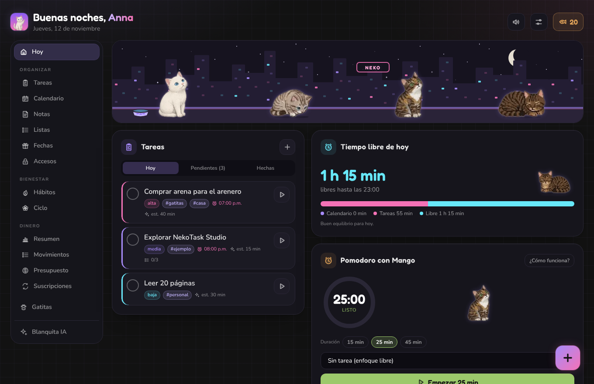
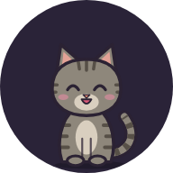
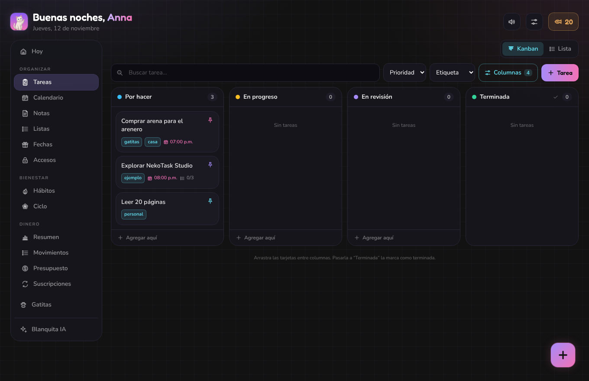
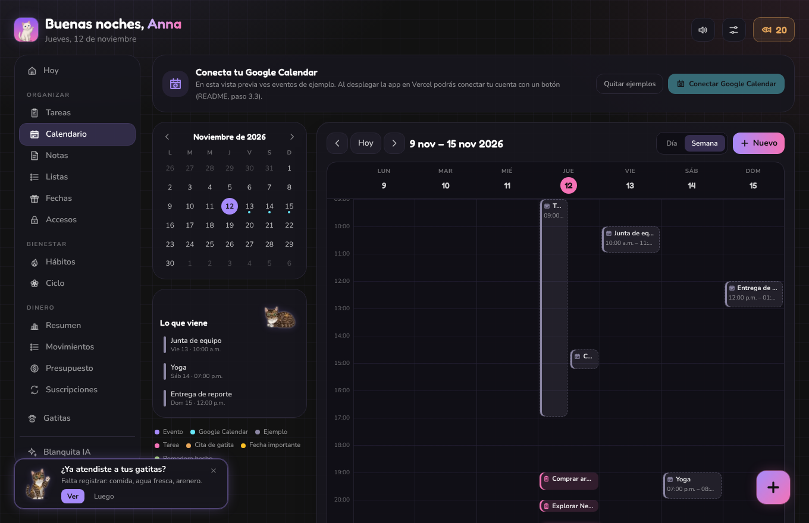
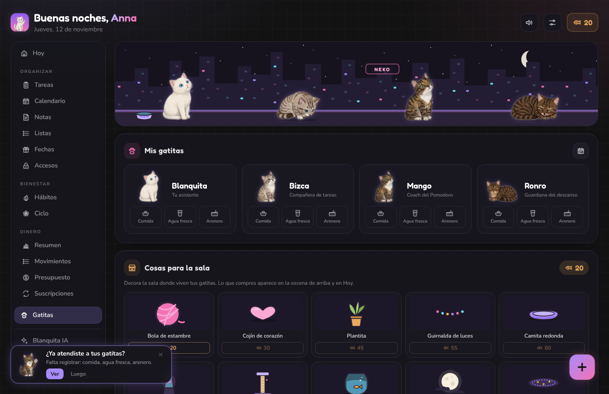
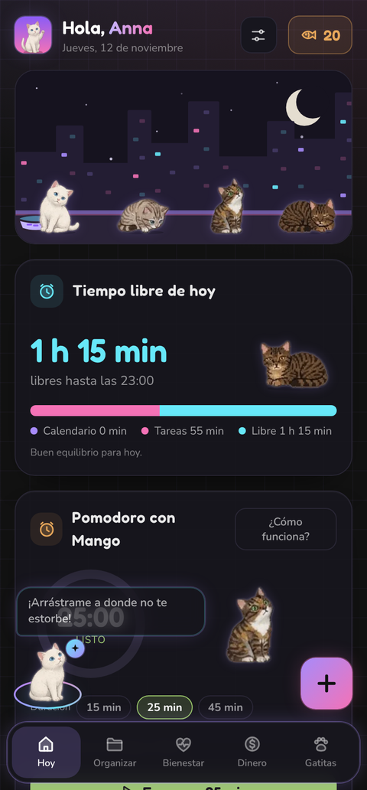
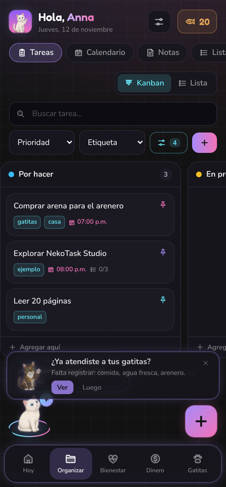
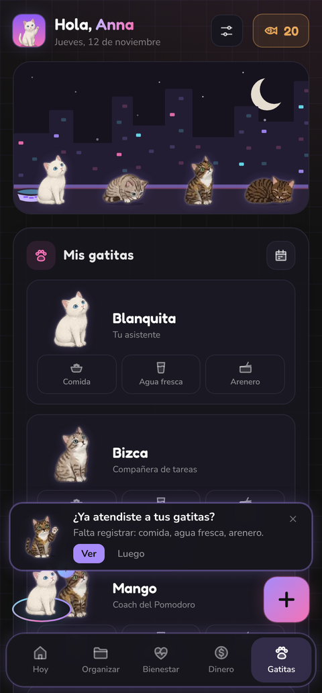

<p align="center">
  
  
  
  
  
  
  
  
</p>

# NekoTask Studio

App personal para organizar tu vida (tareas, calendario, notas, listas, dinero, hábitos, ciclo y contraseñas) con temática kawaii/cyberpunk. La protagonizan **Blanquita, Bizca, Mango y Ronro**, pintadas a partir de sus sprites.



| | Gatita | Rol en la app | Reacciona cuando… |
|:---:|---|---|---|
|  | Blanquita | **Asistente IA** (burbuja flotante que puedes mover) | le preguntas algo · te da ideas según tu día · es el logo de la app |
|  | Bizca | Tareas y fechas importantes | completas una tarea o una lista · te avisa de cumpleaños y fechas |
|  | Mango | Pomodoro y dinero | inicias o terminas un Pomodoro · te avisa de cobros y presupuesto · cuida las citas de las gatitas |
|  | Ronro | Descanso y bóveda | marcas hábitos · te recuerda tus rutinas · cuida la bóveda de accesos |

## Lo más interesante por dentro

| | |
|---|---|
| 🔄 **Sincronización entre dispositivos** | Todo vive en una sola tabla de registros; funciona sin internet y sube solo lo que cambió. |
| 🔐 **Bóveda cifrada en el dispositivo** | PBKDF2 con 600 000 vueltas y AES-GCM; a la nube solo llegan datos cifrados. Se abre con huella (WebAuthn). |
| 📲 **App instalable** | Service worker, modo sin conexión, atajos, *Compartir con NekoTask* y notificaciones push. |
| 🤖 **Asistente con contexto** | Blanquita ve tus tareas, calendario y hábitos del día, y responde en streaming con Claude o Gemini. |
| 🎨 **Sprites propios** | 65 poses por gatita en atlas WebP, generados con scripts de Python a partir de las ilustraciones. |

## Capturas

| Tareas en Kanban | Calendario |
|:---:|:---:|
|  |  |

| Gatitas y sala | En el celular |
|:---:|:---:|
|  |    |

Las capturas vienen de la vista previa (`npm run vista-previa`) con los datos de ejemplo.

---

## Qué tiene

| Área | Pantallas |
|---|---|
| **Hoy** | Escena de las gatitas con su sala decorada · fechas que vienen · tiempo libre · Pomodoro (en compu también tareas y hábitos) |
| **Organizar** | **Tareas** en Kanban (columnas editables) o lista · **Calendario** con Google · **Notas** · **Listas** (con precios para el súper) · **Fechas** importantes · **Accesos** (bóveda de contraseñas cifrada) |
| **Bienestar** | **Hábitos** y rutinas · **Ciclo** (solo los días, con predicción) |
| **Dinero** | **Resumen** del mes · **Movimientos** · **Presupuesto** por categoría · **Suscripciones** con aviso de cobro (todo en MXN) |
| **Gatitas** | Cuidados y citas · **Cosas para la sala** (decoración con croquetas) |
| **Blanquita IA** | Platicar, redactar, resumir, ideas, desglosar tareas y planear el día (Claude o Gemini) |

En el celular el menú de abajo es **Hoy · Organizar · Bienestar · Dinero · Gatitas**, con pestañas arriba; Blanquita es la burbuja flotante. En la compu todo queda en la barra lateral.

### Estado

- [x] **Fase 1:** dashboard, gatitas, tareas, hábitos, Pomodoro, cuidado de gatitas, croquetas
- [x] **Fase 2:** calendario con Google Calendar en ambos sentidos, Blanquita IA, notas
- [x] **Fase 2b:** cuenta (Google o enlace al correo) y sincronización en vivo entre celular y compu
- [x] **Fase 3a:** app instalable, funciona sin internet, accesos directos, *Compartir con NekoTask*, notificaciones push
- [x] **Fase 4:** menú por áreas, notas, listas con precios, fechas, dinero, ciclo, sprites pintados, sala decorable, logo nuevo
- [x] **Fase 5:** bóveda de accesos con huella y carpetas, Kanban de tareas
- [ ] **Pendiente:** widget de Android y WhatsApp → app
- Se quitó el apartado de **Agua** (el historial se conserva en la base de datos).

---

## 1. Arquitectura

```
nekotask-studio/
├── public/
│   ├── sw.js                          # service worker: sin internet + notificaciones (sube VERSION al cambiar íconos/sprites)
│   ├── sprites/                       # atlas WebP de cada gatita (65 poses)
│   └── iconos/                        # logo, atajos, insignia y una carita por gatita
├── src/
│   ├── app/
│   │   ├── page.tsx · layout.tsx · manifest.ts · compartir/page.tsx
│   │   └── api/
│   │       ├── ia/                    # Blanquita (Claude | Gemini, streaming)
│   │       ├── calendario/ · google/  # Google Calendar (OAuth + eventos)
│   │       ├── push/                  # suscribir dispositivo · notificación de prueba
│   │       └── recordatorios/         # lo llama el cron de Supabase cada 10 min
│   ├── components/
│   │   ├── dashboard/                 # Dashboard (menú), Tareas + Kanban, hábitos, tiempo, gatitas
│   │   ├── organizar/                 # Notas, Listas, Fechas, Accesos (bóveda)
│   │   ├── bienestar/                 # Ciclo
│   │   ├── dinero/                    # Resumen, movimientos, presupuesto, suscripciones
│   │   ├── gatitas/                   # Gatita (sprites), escena, sala, decoración
│   │   ├── calendario/ · asistente/   # Calendario · Blanquita y su burbuja
│   │   ├── cuenta/ · ajustes/         # entrada, avisos · ajustes y recordatorios
│   │   └── iconos/ · efectos/ · ui/
│   ├── store/                         # Zustand + persistencia local (con migraciones)
│   └── lib/
│       ├── boveda/                    # cripto.ts (cifrado, generador, medidor) · huella.ts (WebAuthn)
│       ├── sync/                      # colecciones.ts (mezcla pura) + motor.ts (Supabase)
│       ├── recordatorios/             # reglas.ts (puras) · enApp.ts · push-servidor.ts
│       ├── dinero.ts · ciclo.ts · kanban.ts · listas.ts · fechasImportantes.ts
│       ├── cuenta/ · pwa/ · ia/ · google/ · supabase/
│       └── eventos.ts · sonidos.ts · fechas.ts · tipos.ts
├── supabase/migrations/               # 0001 esquema · 0002 calendario/IA · 0003 sync/push
└── scripts/
    ├── vista-previa/                  # HTML único con la app (sprites incrustados)
    ├── iconos/                        # logo.py (logo e íconos desde el sprite) · construir.mjs
    ├── sprites/                       # quitar fondo, recortar con plantilla y armar atlas
    └── pruebas/                       # 8 grupos de pruebas de lógica
```

### Cómo se sincroniza

Cada elemento (una tarea, una nota, un gasto, un acceso cifrado…) es una fila en `sync_registros`:

```
celular ──cambio──▶ store ──(1.2 s)──▶ sube solo lo que cambió ──▶ Supabase ──en vivo──▶ compu
                                       ◀── baja lo nuevo al abrir, al volver a la pestaña y cada minuto
```

- Funciona sin internet: todo se guarda en el dispositivo y se sube al reconectar.
- Si editas lo mismo en dos dispositivos, gana la última versión que llegó a la nube.
- Las croquetas se recalculan sumando sus movimientos, así no se pierden si ganas en ambos a la vez.
- Las colecciones nuevas no necesitan migración: todo vive en `sync_registros`.
- Se quedan solo en cada dispositivo: la clave de acceso de Blanquita, el Pomodoro en curso, la conexión de Google Calendar, la huella de la bóveda y la posición de la burbuja.

### Bóveda de accesos

```
contraseña maestra ──PBKDF2-SHA256 (600 000 vueltas)──▶ llave maestra
llave maestra ──AES-GCM──▶ envuelve la llave de la bóveda (32 bytes al azar)
llave de la bóveda ──AES-GCM──▶ cifra cada acceso y cada carpeta completos
huella (WebAuthn PRF) ──HKDF──▶ envuelve la misma llave, solo en ese dispositivo
```

- A la nube solo llegan la sal, la llave envuelta y los registros cifrados; ni el nombre de una cuenta o carpeta es legible.
- Si la contraseña maestra se olvida, **no hay forma de recuperarla**.
- Se cierra sola a los 2 minutos sin uso, al salir de la app o al cambiar de sección. Ver o copiar una contraseña vuelve a pedir la huella. Lo copiado se borra del portapapeles a los 30 s.
- Blanquita, las notificaciones y WhatsApp nunca ven la bóveda.
- La huella funciona en la app instalada con Chrome; dentro de un marco (vista previa) se usa la contraseña maestra.

### Recordatorios

| Gatita | Cuándo avisa |
|---|---|
| Ronro | A la hora de tu rutina de mañana o noche, si falta algún hábito |
| Bizca | Minutos antes de una tarea con hora · el día de una fecha importante y los días antes que elijas |
| Mango | Antes de cada cobro de suscripción · citas de las gatitas y, a las 8 p. m., si falta su comida, agua fresca o arenero |
| Blanquita | Aviso **discreto** antes del ciclo: "Tienes algo pendiente en Bienestar", sin mencionar de qué se trata |

Con la app abierta aparecen como avisos dentro de la app. Con la app cerrada llegan como notificación (necesita cuenta, llaves VAPID y el cron). Todos se prenden o apagan en **Ajustes → Recordatorios**.

---

## 2. Correr en tu computadora

```bash
npm install
cp .env.example .env.local      # llena lo que vayas a usar
npm run dev                      # http://localhost:3000
npm run vista-previa             # dist/nekotask-vista-previa.html
```

Pruebas de lógica (sincronización, recordatorios, fechas, dinero, ciclo, listas, Kanban y bóveda):

```bash
for t in sync recordatorios fechas dinero ciclo listas kanban boveda; do
  npx esbuild scripts/pruebas/$t.prueba.ts --bundle --platform=node --outfile=/tmp/$t.cjs && node /tmp/$t.cjs
done
```

Sprites y logo (Python con Pillow y SciPy):

```bash
python3 scripts/sprites/quitar_fondo.py hoja.png hoja-rgba.png        # fondo negro → transparente
python3 scripts/sprites/recortar_plantilla.py hoja-rgba.png indice_blanquita.json 1029 salida/
python3 scripts/sprites/atlas.py salida/ mango public/sprites src/components/gatitas/atlas
python3 scripts/iconos/logo.py cuadro_blanquita_saludo.png public/iconos
```

---

## 3. Despliegue paso a paso

### 3.1 GitHub y Vercel
1. Sube el proyecto a un repositorio privado de GitHub.
2. En [vercel.com](https://vercel.com) → **Add New → Project** → importa el repo → **Deploy**.
3. Anota tu dirección, por ejemplo `https://nekotask-anna.vercel.app`. Cada commit vuelve a desplegar solo.

> GitHub acepta hasta 100 archivos por subida desde el navegador; si son más, súbelos en dos tandas.

### 3.2 Supabase
1. Crea un proyecto en [supabase.com](https://supabase.com).
2. **SQL Editor**: ejecuta en orden `0001_esquema_inicial.sql`, `0002_calendario_y_blanquita.sql` y `0003_cuenta_sync_recordatorios.sql`.
3. **Authentication → URL Configuration**: *Site URL* = tu dirección de Vercel. En *Redirect URLs* agrega esa dirección y `http://localhost:3000`.
4. **Authentication → Providers → Email**: déjalo activo (enlace al correo).
5. **Project Settings → API**: copia a Vercel `NEXT_PUBLIC_SUPABASE_URL`, `NEXT_PUBLIC_SUPABASE_ANON_KEY` y `SUPABASE_SERVICE_ROLE_KEY`.

### 3.3 Google Cloud (entrar con Google + Calendar)
1. [console.cloud.google.com](https://console.cloud.google.com) → crea el proyecto "NekoTask".
2. **APIs y servicios → Biblioteca** → **Google Calendar API** → *Habilitar*.
3. **Pantalla de consentimiento de OAuth** → *Externo* → permisos `calendar.events` → tu Gmail como usuario de prueba.
4. **Credenciales → ID de cliente de OAuth → Aplicación web**, con estos URI de redireccionamiento:
   - `https://TU-APP.vercel.app/api/google/callback` (Calendar)
   - `https://TU-PROYECTO.supabase.co/auth/v1/callback` (Entrar con Google)
   - `http://localhost:3000/api/google/callback` (pruebas locales)
5. Copia *Client ID* y *Client secret*:
   - En Vercel: `GOOGLE_CLIENT_ID`, `GOOGLE_CLIENT_SECRET` y `GOOGLE_COOKIE_SECRET` (genéralo con `node -e "console.log(require('crypto').randomBytes(32).toString('hex'))"`).
   - En Supabase: **Authentication → Providers → Google**, con los mismos dos valores.
6. Para que Google no pida reconectar cada 7 días, pasa la pantalla de consentimiento a **En producción**. La primera vez verás "app no verificada": *Configuración avanzada → Ir a NekoTask*.

### 3.4 Blanquita IA
- `ANTHROPIC_API_KEY` desde [platform.claude.com](https://platform.claude.com) y, opcional, `GEMINI_API_KEY` desde [aistudio.google.com](https://aistudio.google.com).
- `NEKO_CLAVE_ACCESO`: una frase larga; ponla también en *Blanquita → ⚙* en cada dispositivo.
- Modelos por defecto: `claude-sonnet-5-5` y `gemini-3.8-flash` (`ANTHROPIC_MODEL` / `GEMINI_MODEL`).
- Blanquita ve tus tareas, calendario de hoy, hábitos y resumen de dinero. **No** ve la bóveda ni el ciclo.

> Con tus llaves personales, lo que escribas se envía a Anthropic o Google con tu cuenta. La versión gratis de Gemini puede usar lo que escribes para entrenar; para cosas del trabajo usa Claude y revisa la política de tu organización.

### 3.5 Notificaciones y recordatorios
1. Genera las llaves: `npx web-push generate-vapid-keys` (o con la página *Llaves de NekoTask*, que lo hace en el navegador).
   - `NEXT_PUBLIC_VAPID_PUBLIC_KEY` = pública · `VAPID_PRIVATE_KEY` = privada · `VAPID_SUBJECT` = `mailto:tu-correo-personal`.
2. Inventa una frase larga para `CRON_SECRET`.
3. **Redeploy** en Vercel.
4. Supabase → **Database → Extensions** → activa `pg_cron` y `pg_net`.
5. **SQL Editor**: ejecuta el bloque comentado del final de `0003` con tu dirección y tu `CRON_SECRET`.
6. En la app: **Ajustes → Notificaciones → Activar** y luego **Probar**.

> En Vercel marca como **Sensitive** todas las variables secretas: `SUPABASE_SERVICE_ROLE_KEY`, `GOOGLE_CLIENT_SECRET`, `GOOGLE_COOKIE_SECRET`, `ANTHROPIC_API_KEY`, `GEMINI_API_KEY`, `NEKO_CLAVE_ACCESO`, `VAPID_PRIVATE_KEY` y `CRON_SECRET`. Solo las que empiezan con `NEXT_PUBLIC_` son públicas.

### 3.6 Instalarla en tu Samsung
1. Abre tu dirección de Vercel en **Chrome** y entra con tu cuenta.
2. Menú **⋮ → Instalar app** (o **Ajustes → Instalar** dentro de NekoTask). Debe quedar en el cajón de apps sin el logo chiquito de Chrome; si sale con él, es un acceso directo: bórralo e instala otra vez.
3. Mantén presionado el ícono para los atajos: **Nueva tarea**, **Blanquita** y **Calendario**.
4. En Samsung Notes: *Compartir* → **NekoTask**, y se guarda en Notas.
5. En la compu entra con la misma cuenta: todo aparece igual.

---

## 4. Detalles de cada sección

- **Tareas:** Kanban con columnas editables (renombrar, color, agregar, quitar, reordenar). La columna marcada como *Terminada* completa la tarea y da sus croquetas. En compu se arrastra; en celular se toca la tarjeta y se elige la columna. Cada tarea tiene checklist, Pomodoro y **Desglosar con Blanquita**.
- **Calendario:** semana o día, mini mes y "Lo que viene". Junta eventos propios y de Google, tareas con fecha, fechas importantes, citas de las gatitas y Pomodoros.
- **Notas:** buscador, etiquetas, fijadas y convertir en tarea. Lo compartido desde otras apps llega aquí.
- **Listas:** reusables ("Reusar" desmarca todo). Con *Llevar cuenta de precios*: `2x leche $28` se lee solo, total estimado, lo que va en el carrito y **Anotar en Dinero**.
- **Fechas:** cumpleaños (con la edad que cumple), aniversarios y vencimientos, con cuenta regresiva.
- **Accesos:** usuario, contraseña, enlace, descripción y carpeta; pegar, copiar, generador de contraseñas y frases, medidor de fuerza y aviso de contraseñas débiles o repetidas.
- **Dinero:** gastos e ingresos en MXN, gráfica por categoría y por día, presupuesto con aviso al 80 %, suscripciones que se anotan al confirmar el cobro.
- **Ciclo:** se marcan solo los días; promedios con tu historial y estimación del próximo periodo y la ventana fértil. Es una estimación: no sirve como método anticonceptivo ni como diagnóstico.

## 5. Base de datos

| Tabla | Para qué |
|---|---|
| `sync_registros` | **Fuente principal**: todo lo de la app, un registro por elemento (los accesos y carpetas van cifrados) |
| `suscripciones_push` · `recordatorios_enviados` | dispositivos que reciben avisos y avisos ya mandados |
| Tablas de `0001` y `0002` | modelo detallado de referencia. La app todavía no escribe en ellas |

## 6. Vista previa en claude.ai

`npm run vista-previa` genera la app completa en un solo HTML, con los sprites incrustados: datos en ese navegador, Blanquita con Claude desde tu cuenta de claude.ai y la bóveda con contraseña maestra. Cuenta, Google Calendar, Gemini, huella, instalación y notificaciones funcionan al desplegar en Vercel.

## 7. Croquetas

| Acción | Croquetas |
|---|---|
| Completar tarea | 3 (baja) · 5 (media) · 8 (alta) · 10 (urgente) |
| Marcar hábito · rutina completa | 3 · +5 |
| Pomodoro completo | 4 |
| Cuidar a una gatita · cita cumplida | 2 · 5 |
| Cosas para la sala | de 20 (estambre) a 150 (luna llena) |
